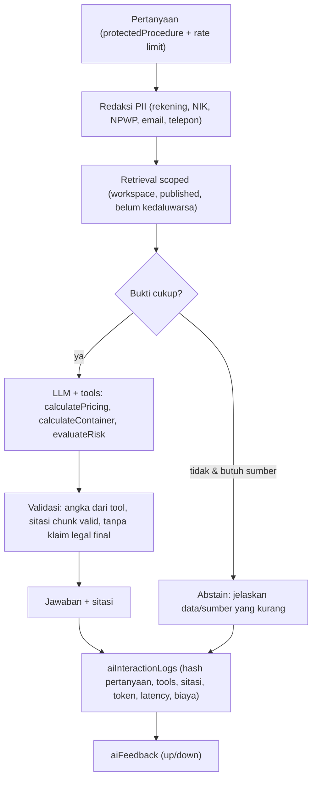

# ADR-002: Arsitektur AI Advisor v2 (RAG + Tool Calling + Evals)

- **Status:** Proposed
- **Tanggal:** 2026-11-22 | **Reversibility:** Two-way door (model/provider, chunking), one-way ringan (skema log & knowledge)

## Context (dari repo)
- Saat ini `assistant.ask` (`server/routers.ts`) memanggil `invokeLLM` (`server/_core/llm.ts`, endpoint Forge `/v1/chat/completions`, model `gpt-5-mini`, `maxTokens: 650`) dengan snapshot JSON mentah di system prompt, rate limit in-memory 20/jam/user, log hanya `console.info`.
- `invokeLLM` sudah mendukung `tools`, `tool_choice`, `response_format` JSON schema, dan retry/backoff.
- Mesin deterministik sudah ada & teruji: `shared/pricing.ts`, `shared/container.ts`, `shared/risk.ts`.
- Dokumen pengetahuan lokal masih `localStorage` (`KnowledgeSource` di `useWorkspaceFlow.ts`).
- Tabel baru (migrasi 0002): `knowledgeDocuments`, `knowledgeChunks`, `aiInteractionLogs`, `aiFeedback`.

## Options
1. **A (dipilih) — RAG di Postgres yang sama + tool calling deterministik + gate abstention.**
   Retrieval: filter `workspaceId` + `status='published'` + `expiresAt` null/masa depan + `revokedAt IS NULL`, lalu peringkat keyword (`tsvector`, ditambahkan di migrasi terpisah) dengan opsi embedding (`pgvector`) bila evals menunjukkan recall kurang.
2. **B — Vector DB eksternal (Pinecone/Weaviate).** Recall lebih baik pada skala besar, tapi tambahan vendor, sinkronisasi izin/revoke, biaya. Tidak perlu pada volume saat ini.
3. **C — Tetap prompt-stuffing snapshot.** Murah tapi tanpa sitasi, rawan halusinasi & kebocoran data.

## Decision — alur permintaan

Aturan: (1) angka harga/muatan/risiko **hanya** dari tool; (2) setiap klaim berbasis dokumen wajib sitasi `[judul vX #chunk]`; (3) tanpa bukti → abstain; (4) tidak ada tool yang memutasi data (read-only) — aksi tetap klik manusia; (5) log menyimpan SHA-256 + jumlah karakter pertanyaan, bukan isi mentah (konsisten dengan praktik sekarang); (6) timeout keras 12 s, fallback ke `getScreenAdvisorInsight` deterministik.

## Evals
Suite 100 kasus (versi di repo, dijalankan di CI dengan model pinned): hitungan Incoterm/muatan (30), 3-way match (15), abstention hukum/pabean/buyer asli (20), prompt-injection & kebocoran PII (15), multi-komoditas (10), sitasi/revoked/expired (10). Gate rilis: ≥95% lulus, **0** klaim legal final, **0** PII lolos. Nilai target = target produk; baseline belum diukur `[Needs data: jalankan eval pada Copilot saat ini]`.

## Model kuota LLM (asumsi, bukan data)
Asumsi `[Assumed — validasi via log produksi]`: 20% DAU memakai AI, 4 pertanyaan/hari, ≈2.200 token/interaksi (target guardrail).
| Skenario | DAU | Pertanyaan/bulan | Token/bulan |
| :--- | ---: | ---: | ---: |
| Tahun 1 | 1.500 | 1.500×0.2×4×30 = 36.000 | ≈ 79 juta |
| Tahun 3 | 10.000 | 10.000×0.2×4×30 = 240.000 | ≈ 528 juta |
Batas keras per user: 20/jam (≈ 2.200×20 = 44k token/jam/user). Biaya = token × harga model `[Needs data: tarif provider Forge/model terpilih]`; `aiInteractionLogs.estimatedCostUsd` menghitung realisasi. Rate limit harus pindah dari in-memory ke penyimpanan bersama sebelum >1 instance (lihat TODO.md).

## Consequences & Triggers
- Tambahan: ingest/chunking dokumen, job reindex saat revoke/expired, anggaran token, pemeliharaan eval.
- Tinjau ulang (Opsi B/pgvector) bila recall@5 < 85% pada eval retrieval atau chunk > ~100k per workspace.
- Izin & lisensi sumber (`licenseNote`) harus diisi sebelum status `published` `[Confirm with Legal]`.
