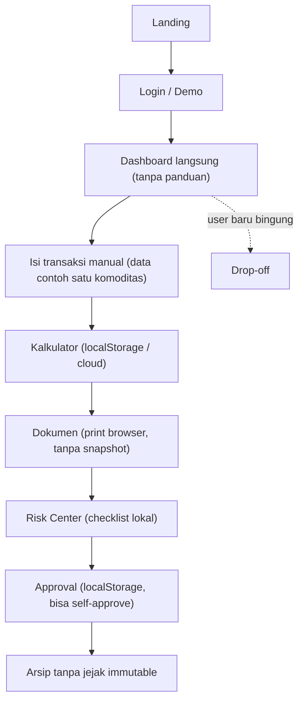
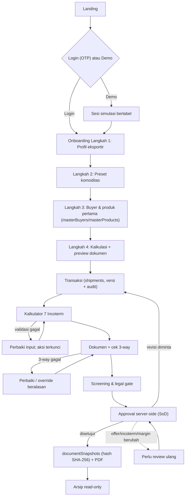

# EksporFlow v2 — Analisis Bisnis: As-Is vs To-Be, State Transition, RTM

Artefak terkait: [requirements-v2.json](./requirements-v2.json) (RTM, 21 requirement, hasil audit `analyze_requirements.py`: `passed: true`, 0 duplikat, 0 yatim, 0 vague).

## 1. Aktor & RACI ringkas

| Aktivitas | Owner/Admin | Editor (Ops/Sales) | Viewer/Auditor | Sistem |
| :--- | :---: | :---: | :---: | :---: |
| Onboarding & master data | A/R | R | I | – |
| Transaksi, kalkulator, dokumen | A | R | I | – |
| Screening & legal gate | A | R | C | – |
| Approval (SoD) | R (reviewer) | R (requester) | I | enforce |
| Terbitkan snapshot dokumen | A | R | I | hash + audit |
| Arsip | A | R | I | read-only |

## 2. As-Is vs To-Be (pengguna baru)

### As-Is (v1.8) — titik sakit

Masalah: tanpa onboarding terpandu; master data & approval di `localStorage` (`useWorkspaceFlow.ts`); dokumen tidak immutable; tidak ada pencegahan self-approval; AI tanpa sitasi/log.

### To-Be (v2)

| Aspek | As-Is | To-Be | Dampak transisi |
| :--- | :--- | :--- | :--- |
| Onboarding | Tidak ada | 4 langkah, TTFV ≤ 5 mnt | Migrasi `onboardingCompletedIds` tetap kompatibel |
| Master data | localStorage | Tabel server + RLS | Impor sekali dari localStorage (opsional) |
| Approval | Lokal, self-approve | `shipmentApprovals` + CHECK SoD | Perlu keputusan owner untuk workspace 1 orang (`selfApprovalDeclared`) |
| Dokumen | Print browser | Snapshot immutable + PDF server | Perlu storage objek `[Confirm: provider storage]` |
| AI | Snapshot mentah | RAG + tools + log + feedback | Log tanpa isi pertanyaan mentah (hash saja) |

## 3. State Transition Matrix

### 3.1 Status transaksi (`ShipmentStatus`)
| Dari | Trigger | Guard | Ke | Efek audit |
| :--- | :--- | :--- | :--- | :--- |
| Draft | Kirim penawaran | Validasi harga lulus | Quotation | audit `updated` |
| Quotation | Buyer setuju + approval `approved` | Approval berlaku (tidak superseded) | Confirmed | audit |
| Quotation | Revisi harga | – | Quotation | approval lama → `superseded` |
| Confirmed | Legal gate selesai + 3-way lulus/override | Review lengkap (bukan klaim legal clearance) | Ready to Ship | snapshot dokumen |
| Ready to Ship | Isi booking | Booking no. terisi | Booked | audit |
| Booked | Stuffing mulai | Container & seal terisi | Stuffing | audit |
| Stuffing | Kapal berangkat | B/L ref terisi | Departed | audit |
| Departed | Konfirmasi transit | – | In Transit | audit |
| In Transit | Dokumen & pembayaran selesai | Piutang 0 | Completed | arsip read-only |
| Draft…Booked | Batalkan | Konfirmasi eksplisit, role ≥ admin | (dihapus/arsip) `[Confirm with Ops: kebijakan cancel]` | audit |

**Terlarang:** loncat Draft→Booked+; mundur dari Departed ke status sebelumnya; edit field komersial saat Completed; hapus transaksi yang punya `documentSnapshots` (FK RESTRICT).

### 3.2 Status approval (`shipmentApprovals.status`)
| Dari | Trigger | Guard | Ke |
| :--- | :--- | :--- | :--- |
| (baru) | Requester ajukan | editor+ | pending |
| pending | Reviewer setuju | reviewer ≠ requester (atau `selfApprovalDeclared`), role admin+ | approved |
| pending | Reviewer minta revisi | komentar wajib | revision_requested |
| revision_requested | Requester ajukan ulang | versi shipment baru | pending (baris baru; lama → superseded) |
| approved | offer/incoterm/margin berubah > 0.01 | – | superseded → perlu review ulang |

**Terlarang:** approved→pending tanpa perubahan; reviewer viewer/editor; approve tanpa `shipmentVersion` cocok.

## 4. Decision table — SoD approval
| Workspace | Requester = Reviewer | `selfApprovalDeclared` | Hasil |
| :--- | :---: | :---: | :--- |
| Multi-anggota | Ya | Tidak | Ditolak (CHECK DB + API) |
| Multi-anggota | Tidak | – | Diizinkan |
| 1 anggota (owner) | Ya | Ya (deklarasi eksplisit, tercatat) | Diizinkan + audit |

## 5. Audit RTM
`analyze_requirements.py audit` → `{"total_requirements": 21, "passed": true, "duplicate_ids": [], "orphan_requirements": [], "vague_requirements": []}`.
Catatan: lulus lint ≠ lulus UAT; ID `TC-*` masih placeholder sampai kasus uji ditulis di Tahap 2–4.

## 6. Keputusan terbuka
- `[Confirm with Legal]` retensi arsip dokumen & log AI (UU PDP).
- `[Confirm with Ops]` kebijakan pembatalan transaksi.
- `[Confirm with Owner]` perilaku approval di workspace 1 orang.
