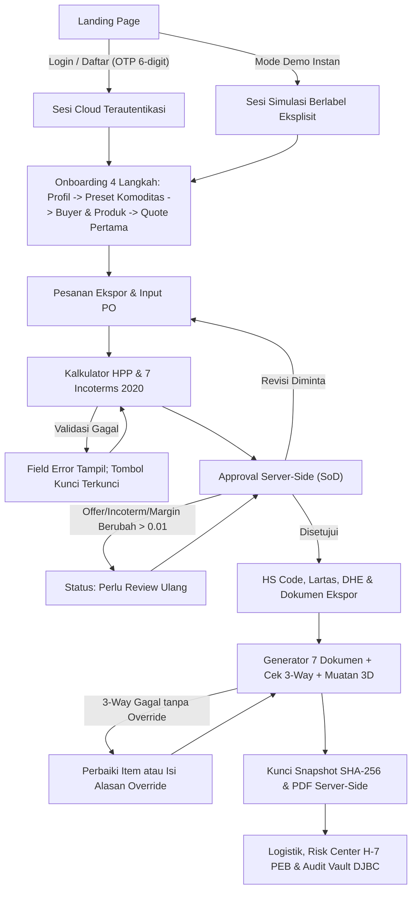

# Product Requirements Document (PRD) — EksporFlow

- **Nama Produk:** EksporFlow — *B2B Export Operations & Trade Command Center*
- **Versi Dokumen:** v2.0 (Konsolidasi Baseline Terbangun v1.8/v2.0 + Target Penyelesaian Penuh v2)
- **Tanggal:** 2026-11-26
- **Status:** Living Master PRD (Sinkron dengan Codebase `d:\Eksporflow`)
- **Dokumen Terkait:**
  - [PRD_ALIGNMENT.md](../../PRD_ALIGNMENT.md)
  - [PRD_V2_BACKLOG.md](./PRD_V2_BACKLOG.md)
  - [AS_IS_TO_BE.md](../ba/AS_IS_TO_BE.md) & [requirements-v2.json](../ba/requirements-v2.json)
  - [MILESTONES_TAHAP_2_4.md](../scrum/MILESTONES_TAHAP_2_4.md)
  - [ADR-001](../adr/ADR-001-deployment-strategy.md), [ADR-002](../adr/ADR-002-ai-advisor-v2.md), [ADR-003](../adr/ADR-003-immutable-snapshots-pdf.md), [ADR-004](../adr/ADR-004-capacity-sla.md)
  - [TODO.md](../../TODO.md)

---

## 1. Ringkasan Eksekutif & Visi Produk

**EksporFlow** adalah platform SaaS *Trade Command Center* berbasis web (desktop-first, responsif untuk layar sempit) bagi eksportir Indonesia—mulai dari UMKM/trader agregator hingga eksportir korporasi—untuk mengelola seluruh siklus ekspor dalam **satu sumber data terpadu** (*single source of truth*).

EksporFlow menyatukan:
1. **Kesiapan & Pra-Transaksi:** Asesmen kesiapan ekspor, akuisisi/verifikasi buyer, dan input/pemindaian Purchase Order (PO/LOI).
2. **Kalkulasi Harga & HPP Akurat:** Struktur HPP Trader (memperhitungkan susut sortasi) & Manufaktur, serta kalkulator **7 Incoterms® 2020** (`EXW`, `FCA`, `FOB`, `CFR`, `CIF`, `DAP`, `DDP`) berbasis formula *net-price margin*.
3. **Dokumen Ekspor & Konsistensi 3-Way:** Generator 7 jenis dokumen (`Proforma Invoice`, `Sales Contract`, `Commercial Invoice`, `Packing List`, `Certificate of Origin`, `Shipping Instruction`, `Draft Bill of Lading`), editor ala Word (11 ukuran kertas, kop perusahaan, tanda tangan digital), OCR validasi silang Draft B/L, serta penguncian snapshot *immutable* (SHA-256).
4. **Perencanaan Muatan & Logistik:** Kalkulator kubikasi/berat per line item dengan *shrinkage*, pallet opsional, simulator **3D Three.js** interaktif, pelacakan kontainer maritim, serta status booking/container/seal.
5. **Kepatuhan, Risiko & Audit:** Pemeriksaan HS Code & Lartas/FTA, kepatuhan DHE SDA, Risk Center & countdown **H-7 PEB**, serta **Audit Vault DJBC** (arsip 5 folder siap audit kepabeanan).
6. **AI Advisor & Pengetahuan Tim:** Copilot operasional dengan redaksi PII, *abstention gate* regulasi, eksekusi *deterministic tool calling*, serta log audit & feedback.

---

## 2. Pernyataan Masalah, Persona & Jobs-to-be-Done (JTBD)

### 2.1 Masalah yang Diselesaikan
Eksportir Indonesia pada umumnya mengelola transaksi ekspor secara terfragmentasi menggunakan spreadsheet terpisah (HPP & harga), Microsoft Word/Excel manual (PI, CI, PL, SI), chat/email untuk persetujuan internal, dan folder lokal tanpa jejak versi:
- **Risiko kesalahan hitung & margin tergerus:** Kesalahan membedakan *markup* vs *net margin*, lupa menghitung susut (*shrinkage*) bahan baku dari petani, atau komponen biaya Incoterms tidak lengkap.
- **Ketidakkonsistenan dokumen (3-Way Mismatch):** Perbedaan quantity, HS Code, net/gross weight, atau nama buyer antara Commercial Invoice, Packing List, dan Draft B/L yang memicu penolakan bea cukai (*notul*) atau keterlambatan kapal (*roll-over*).
- **Ketidakpastian kepatuhan & bukti audit:** Kesulitan melacak izin lartas/karantina/COO, tenggat H-7 PEB, kewajiban DHE SDA, serta ketiadaan bukti dokumen yang terkunci (*immutable*) saat audit DJBC atau sengketa buyer.
- **Hambatan pengguna baru (drop-off):** Eksportir baru bingung memulai tanpa contoh komoditas yang relevan dan panduan terstruktur. `[Assumed — validasi melalui funnel onboarding & wawancara user]`

### 2.2 Target Persona & RACI

| Persona / Role | Peran di Workspace (`workspaceRole`) | Jobs-to-be-Done (JTBD) Utama |
| :--- | :--- | :--- |
| **Direktur / Pemilik Usaha Ekspor** | `owner` / `admin` | Menyetujui penawaran strategis (*Segregation of Duties*), memantau margin & risiko transaksi, menjaga kepatuhan DHE & audit DJBC, mengelola tim. |
| **Staf / Manajer Ops & Sales Ekspor** | `editor` | Menyusun HPP & quotation 7 Incoterms, mengelola master buyer/produk, menerbitkan dokumen CI/PL/SI/COO/Draft B/L, merencanakan stuffing kontainer, dan mengawal jadwal PEB/ETD. |
| **Auditor / Konsultan / Viewer** | `viewer` | Meninjau jejak transaksi, status kepatuhan, *document snapshots*, dan arsip Audit Vault secara *read-only* tanpa risiko mengubah data. |
| **Tim Keuangan (Fase Lanjutan)** | `admin` / `editor` `[Planned]` | Memantau piutang/hutang (AR/AP), rekonsiliasi pembayaran buyer vs kurs realisasi, dan pratinjau jurnal akuntansi. |

---

## 3. Tujuan Bisnis, Metrik Keberhasilan & Guardrail Metrics

> [!IMPORTANT]
> Setiap metrik target wajib dipasangkan dengan **Guardrail Metric** agar optimasi kecepatan atau adopsi tidak mengorbankan akurasi finansial, keamanan data, atau kepatuhan hukum.

| Kategori | Metrik | Target | Guardrail Metric (Batas Aman) | Sumber / Catatan |
| :--- | :--- | :--- | :--- | :--- |
| **Aktivasi & Onboarding** | *Time-to-First-Valid-Quote* (TTFV) | `<= 5 menit` (p75) dari Landing ke kalkulasi + preview PI pertama | **Dummy Data Pollution:** `0%` data demo masuk ke laporan keuangan / transaksi disetujui (`isDemo` berlabel eksplisit) | `[Assumed — ukur via telemetry]` |
| **Aktivasi & Onboarding** | *Onboarding 4-Step Completion Rate* | `>= 75%` pengguna baru menyelesaikan 4 langkah | **Validation Error Loop:** `< 5%` sesi mengalami `> 2x` error berulang di langkah yang sama | `PRD_V2_BACKLOG.md` |
| **Integritas Dokumen & Kontrol** | *3-Way Consistency Pass Rate* | `100%` snapshot dokumen terkunci lulus cek 3-way atau mencatat alasan *override* | **Silent Overwrite Rate:** `0%` (konflik `version` wajib return HTTP 409 / `CONFLICT`) | `requirements-v2.json` |
| **Integritas Dokumen & Kontrol** | *Approval SoD Compliance* | `100%` persetujuan multi-anggota memisahkan requester vs reviewer | **Stale Approval Rate:** `0%` transaksi berstatus *Approved* tetap aktif jika `offer`, `incoterm`, atau `margin` berubah `> 0.01` | `AS_IS_TO_BE.md` |
| **Kualitas AI Advisor** | *Deterministic Calculation Accuracy* | `100%` hitungan HPP, Incoterm, kontainer, dan risiko memakai *deterministic tools* | **Unverified Legal Claim Rate:** `0%` klaim bahwa AI = izin resmi Bea Cukai/PEB atau jaminan buyer | `ADR-002` |
| **Kualitas AI Advisor** | *Grounded Citation & Eval Pass Rate* | `>= 90%` jawaban SOP menyertakan sitasi; `>= 95%` lulus *100-Case Eval Suite* | **PII Leakage Rate:** `0%` NIK/NPWP/rekening/email mentah dikirim ke LLM; kuota `<= 20 tanya/jam/user` | `ADR-002`, `aiSanitizer.ts` |
| **Performa & Keandalan** | Latensi API, PDF & AI | PDF server `<= 3.0 dtk` (p95); AI Advisor `<= 4.5 dtk` (p95, timeout `12 dtk`) | **SLA Uptime:** `>= 99.9%/bln` (error budget `<= 43.2 menit/30 hari`); DB migration `0 DROP/TRUNCATE` | `NFR-002`, `NFR-003`, `NFR-004`, `NFR-006` |
| **UX & Aksesibilitas** | *End-to-End Task Completion* | `>= 85%` pengguna menyelesaikan alur transaksi tanpa tersesat navigasi | **WCAG 2.1 AA:** Kontras teks `>= 4.5:1`, angka `tabular-nums`, status wajib berlabel teks + ikon | `NFR-005` |

---

## 4. Ruang Lingkup Produk: Status Terbangun vs. Gap V2 & Non-Goals

### 4.1 Pemetaan Status Aktual terhadap Codebase (`d:\Eksporflow`)

| Domain / Modul | Sudah Terbangun di Codebase (Verified) | Gap / Belum Selesai Penuh (Target Penyelesaian V2) |
| :--- | :--- | :--- |
| **Autentikasi & Tenancy** | Email + password, OTP verifikasi 6 digit & reset password (`authService.ts`), dev login lokal (`/api/dev/login`), `users`, `emailVerificationCodes`, `workspaces`, `workspaceMembers` (`owner/admin/editor/viewer`) + RLS aktif. | Integrasi uji end-to-end DB dengan `DATABASE_URL` live; migrasi rate limit dari in-memory (`rateLimit.ts`) ke penyimpanan bersama (Redis/Postgres) untuk multi-instance. |
| **Transaksi & Persistensi** | Tabel `shipments`, `shipmentLineItems`, `shipmentAuditLogs`; endpoint protected tRPC `shipments.*` dengan *optimistic locking* (`version`), transaksi atomik DB, & fallback `localStorage` saat mode draft lokal/offline. | Uji integrasi RLS & konflik versi terhadap Supabase Postgres live; kebijakan cancel/soft-delete terstandardisasi oleh Ops. |
| **Master Data & Undangan** | Skema DB & tRPC `masterBuyers.*`, `masterProducts.*`, `invitations.*` (`masterDataDb.ts`) dengan scoping `workspaceId`, role `editor+`/`admin+`, dan optimistic lock. | Sinkronisasi penuh UI `PartnersView` & `ProductsView` + wizard impor sekali jalan dari `localStorage` lama (`useWorkspaceFlow.ts`) & flow *accept invitation* di UI. |
| **Onboarding & Multi-Komoditas** | `GuidedOnboardingModal.tsx` dengan **4 langkah** dan preset sektor komoditas (`SECTOR_PRESETS`: Kopi, Perikanan, dll.), HS Code, kemasan, susut. | Instrumentasi metrik TTFV & *completion rate*; validasi kurasi HS Code bersama ahli ekspor. |
| **Kalkulator HPP & 7 Incoterms** | `shared/hpp.ts` (mode Trader & Manufacturer, yield ratio susut), `shared/pricing.ts` (7 Incoterms 2020, formula net-price, contingency terpisah, validasi), `ratesService.ts` (kurs live + fallback). | Fixture tests tambahan untuk edge case kurs/margin ekstrem & integrasi penuh dengan *auto-invalidation* approval server-side. |
| **Document Engine & Snapshot** | 7 tipe dokumen, 11 ukuran kertas (`PAPER_SIZE_SPECS`), 3 template, preview ID/EN, print EN, Word-style ribbon (`DocWordRibbon.tsx`), logo/kop crop, tanda tangan digital modal, OCR Draft B/L (`DocumentScrutinyModule.tsx`), skema `documentSnapshots` + tRPC `snapshots.*` (hash SHA-256 kanonik + audit log). | **Renderer PDF Server-Side** (headless Chromium + `storagePut` + signed URL sesuai `ADR-003`), pemblokiran snapshot jika 3-way gagal tanpa `overrideReason`, dan penyesuaian `deleteShipment` agar return `CONFLICT` rapi saat ber-snapshot. |
| **Approval & SoD** | Tabel `shipmentApprovals` (dengan `CHECK` DB anti self-approval) pada skema Drizzle & layar `ApprovalsView` di UI. | **tRPC router `approvals.*` belum ada di `server/routers.ts`**; logika *auto-supersede* saat `offer`/`incoterm`/`margin` berubah `> 0.01` dan binding penuh UI ke DB. |
| **Muatan Kontainer & 3D** | `shared/container.ts` (20GP/40GP/40HC, net/gross/pallet weight, shrinkage loss, pallet per item, kemasan custom) + viewport **Three.js** interaktif (`ContainerModule.tsx`) + `TrackingModule.tsx`. | Penyempurnaan batas unit visual & label disclaimer di semua state responsif; pelacakan kapal saat ini bersifat simulasi/input manual (bukan live AIS API). |
| **Kepatuhan, Risk & Audit Vault** | `ComplianceLartasModule.tsx` (BTKI/FTA/Lartas, DHE SDA), `RiskModule.tsx` (4 legal gate, screening PO/email, H-7 PEB countdown, status `Review complete — verify`), `AuditVaultModule.tsx` (5 folder audit DJBC). | Konfirmasi kebijakan retensi arsip dengan Legal (UU PDP). |
| **AI Advisor & Pengetahuan Tim** | `aiSanitizer.ts` (redaksi PII + SHA-256 prompt), `aiGuardrails.ts` (abstention HS tak terverifikasi), `aiAdvisorTools.ts` (`calculateHpp`, `calculateContainerFit`, `assessExportRisk`), `aiAuditDb.ts` (`aiInteractionLogs` & `aiFeedback`), `assistant.*` di `routers.ts`. | **RAG dari `knowledgeDocuments` & `knowledgeChunks`** belum terhubung ke `assistant.ask` (masih memakai `HS_REFERENCE_CATALOG` & `localStorage`), endpoint CRUD `knowledge.*` & pipeline chunking/expiry, serta **100-Case Eval Suite** otomatis di CI. |
| **Keuangan, Bank, Jurnal & Laporan** | Layar `FinanceView`, `BankView`, `JournalsView`, `ReportsView` dengan kontrol pemisahan tegas antara dokumen dagang dan posting akuntansi. | Implementasi tabel & logika ledger akuntansi/rekonsiliasi bank nyata di backend (menunggu keputusan Finance owner). |

### 4.2 Explicit Non-Goals (Di Luar Ruang Lingkup V2)
Untuk mencegah *scope creep* dan ekspektasi hukum yang keliru, EksporFlow secara eksplisit **TIDAK** mencakup:
1. **Bukan Portal Pengajuan Resmi Pemerintah:** Tidak mengirim data langsung ke sistem **CEISA 4.0** (Bea Cukai), **INSW**, **OSS**, atau **e-SKA** (Kemendag). EksporFlow menyiapkan paket data & dokumen pra-pengajuan yang akurat.
2. **Bukan Penerbit Original Bill of Lading:** Semua B/L yang dihasilkan berlabel `DRAFT / SHIPPING INSTRUCTION REFERENCE — NOT CARRIER ISSUED` dan tidak mengikat maskapai pelayaran.
3. **Bukan Verifikasi KYC/KYB Live Pemerintah & Sanksi Global Real-Time:** Tidak terhubung langsung ke API AHU, DJP, atau database OFAC/UN secara real-time. Screening buyer dilakukan berbasis bukti dokumen & checklist operasional.
4. **Bukan Jaminan Hukum, Keselamatan Muatan, atau Laba Aktual:** Kalkulator, Risk Center, 3D Stuffing, dan AI Advisor adalah alat bantu operasional. Tidak menggantikan pemeriksaan PPJK, forwarder, surveyor, bank, maupun penasihat hukum.
5. **Bukan Aplikasi Mobile Native atau Vector DB Terpisah:** Fokus pada *Desktop-First B2B Command Center* (tetap responsif di tablet/mobile) dan RAG berbasis PostgreSQL (`ADR-002`).

---

## 5. Arsitektur Informasi & Alur Pengguna (24 Layar + Auth/Onboarding)

Seluruh workspace diorganisasikan dalam **7 Grup Navigasi Sidebar** (`WorkspaceShell.tsx`) dengan total **24 layar aktif** yang dapat diakses via query `?screen=<id>`:

1. **Ringkasan:**
   - `dashboard` — Dashboard Ekspor (KPI transaksi aktif, kepatuhan devisa, filter pelabuhan, tabel paginasi 12+ shipment).
   - `readiness` — Asesmen Kesiapan Ekspor (evaluasi legalitas badan usaha, pengalaman ekspor, sertifikasi komoditas).
2. **Penjualan:**
   - `pre_transaction` — Pra-Transaksi & Buyer (surat minat/inquiry, quotation awal, verifikasi prospek).
   - `transactions` — Pesanan Ekspor (control tower status Draft s.d. Completed, referensi transaksi).
   - `po_intake` — Input Purchase Order (`PoIngestionModal.tsx`, pemindaian teks/file PO/LOI).
   - `pricing` — Harga & Order (HPP Trader/Manufacturer, 7 Incoterms 2020, kurs referensi, margin & diskon).
   - `approvals` — Persetujuan (workflow review perubahan harga/margin/Incoterm & SoD).
3. **Operasional Ekspor:**
   - `compliance` — HS Code & Kepatuhan Lartas (BTKI, FTA/CEPA, lartas kementerian, kepatuhan DHE SDA).
   - `documents` — Dokumen Ekspor (7 dokumen, Word ribbon, 11 ukuran kertas, kop, tanda tangan, snapshot).
   - `cargo` — Rencana Muatan Kontainer (multi-kemasan, pallet, susut, simulator 3D Three.js).
   - `tracking` — Pelacakan Kontainer Maritim (status kontainer & jadwal pelayaran).
   - `shipment` — Logistik & Pengiriman (booking kapal, nomor kontainer/seal, checklist serah terima).
   - `scrutiny` — Validasi Silang Draft B/L (OCR & komparasi 3-way Draft B/L vs CI vs PL).
   - `risk` — Risk Center & H-7 PEB (4 legal gate, 3-way check, bukti PO/email, countdown closing PEB).
   - `audit_vault` — Arsip Digital Audit DJBC (5 folder kepabeanan: Pra-Transaksi, Komersial, Kepabeanan/Lartas, Logistik/B/L, Pembayaran/TT).
4. **Advisor & Pengetahuan:**
   - `advisor` — AI Advisor (chat kontekstual transaksi, sitasi, tool calling, feedback thumbs up/down).
   - `knowledge` — Pengetahuan Tim (manajemen SOP & panduan pasar dengan lifecycle & expiry).
5. **Data Utama:**
   - `partners` — Mitra & Kontak (master data buyer/consignee & importir).
   - `products` — Katalog Produk (master spesifikasi produk, HS Code, kemasan & dimensi standar).
6. **Keuangan & Analitik:**
   - `finance` — Keuangan AR / AP (rencana piutang & pemisahan dokumen dagang vs pengakuan pendapatan).
   - `bank` — Rekonsiliasi Bank (pencocokan DP/pelunasan & selisih kurs realisasi).
   - `journals` — Jurnal & Bagan Akun (pratinjau jurnal double-entry & kebijakan reversal).
   - `reports` — Laporan & Analitik (struktur biaya, estimasi margin per shipment, asumsi vs realisasi).
7. **Administrasi:**
   - `settings` — Pengaturan Workspace (autentikasi, koneksi Supabase Postgres, RLS, undangan tim, ekspor data).

### Alur Pengguna Ujung-ke-Ujung (To-Be Flow)

---

## 6. Kebutuhan Fungsional (Functional Requirements) & Kriteria Penerimaan

| ID | Modul / Kemampuan | Prioritas | Acceptance Criteria (Given / When / Then) | Edge, Error & Failure States |
| :--- | :--- | :---: | :--- | :--- |
| **FR-001** | **Autentikasi OTP & Mode Demo** | Must | **Given** pengguna di Landing Page; **When** mendaftar dengan email & password (`min 8 char`) atau masuk Mode Demo; **Then** registrasi mengirim OTP 6-digit (`emailVerificationCodes`), dan Mode Demo masuk ke sesi simulasi dengan label status demo yang eksplisit (tidak mengklaim persetujuan produksi). | Rate limit auth (`25 req / 15 menit` per email/IP) return `TOO_MANY_REQUESTS`; OTP kedaluwarsa/salah > batas ditolak dengan opsi kirim ulang. |
| **FR-002** | **Guided Onboarding 4 Langkah** | Must | **Given** pengguna baru pertama kali masuk; **When** membuka Wizard Onboarding; **Then** sistem memandu 4 langkah: (1) Identitas eksportir & NPWP/NIB, (2) Pilih preset komoditas, (3) Setup buyer & produk pertama, (4) Simulasi kalkulasi & preview dokumen pertama. | Pengguna dapat menutup/melanjutkan onboarding kapan saja; data simulasi wajib bertanda `Draft Simulasi` dan tidak mencemari laporan riil. |
| **FR-003** | **Preset Multi-Komoditas** | Must | **Given** langkah 2 onboarding; **When** pengguna memilih sektor (Perkebunan/Kopi, Perikanan/Udang, Manufaktur/Pangan Olahan, Kerajinan/Furnitur); **Then** sistem mengisi otomatis HS Code, jenis kemasan, dimensi, berat/unit, dan persentase susut default yang tetap dapat diedit. | Jika user memilih *"Kemasan lain"*, input dimensi `(P×L×T)` dan berat kustom wajib tersedia dan ikut terhitung. |
| **FR-004** | **Master Data Buyer & Produk CRUD** | Must | **Given** user ber-role `editor`+; **When** membuat, mengubah, mengarsipkan, atau menghapus `masterBuyers` atau `masterProducts`; **Then** operasi tersimpan ke PostgreSQL terikat `workspaceId`, memeriksa `version` (*optimistic lock*), dan dapat diterapkan satu klik ke transaksi aktif. | Role `viewer` melihat tombol edit/hapus nonaktif; duplikat nama buyer atau SKU dalam 1 workspace mengembalikan `CONFLICT`. |
| **FR-005** | **Manajemen Tim & Undangan** | Must | **Given** `owner`/`admin`; **When** mengundang email dengan role (`admin`/`editor`/`viewer`); **Then** record dibuat di `workspaceInvitations` dengan `tokenHash`, masa berlaku 7 hari, dan status `pending` hingga diterima atau di-`revoke`. | Non-admin ditolak (`FORBIDDEN`); token kedaluwarsa/revoked tidak dapat dipakai bergabung. |
| **FR-006** | **Kalkulator HPP & 7 Incoterms 2020** | Must | **Given** transaksi aktif; **When** mengisi HPP (mode Trader dengan susut `0–80%` atau Manufacturer) dan biaya logistik dari `EXW` hingga `DDP`; **Then** sistem menghitung `offer = max(0, (cost / (1 - targetMargin)) - discount)` dengan *contingency* masuk ke `cost`, menampilkan perbandingan 7 skenario Incoterms, *formulaVersion*, kurs referensi + tanggal sumber. | Jika `quantity <= 0`, `exchangeRate <= 0`, `margin < 0` atau `>= 100`, `discount < 0`, atau `namedPlace` kosong, tampilkan error spesifik per field dan kunci aksi finalisasi quote. |
| **FR-007** | **Rencana Muatan Kontainer & 3D** | Must | **Given** daftar line item dengan kemasan & pallet opsional; **When** memilih kontainer (`20GP`/`40GP`/`40HC`); **Then** sistem menghitung terpisah *product volume*, *pallet volume*, *net weight*, *gross weight*, *pallet weight*, dan *shrinkage loss* (catatan: susut tidak mengurangi gross weight fisik ketika `shrinkage = 100%` tidak fallback ke gross), plus viewport 3D Three.js (Isometric/Samping/Atas + Reset View). | Jika utilisasi volume atau berat `> 100%`, tampilkan peringatan overload eksplisit; 3D membatasi unit visualisasi agar browser tidak hang dan menampilkan disclaimer *"Alat bantu estimasi, bukan sertifikasi keselamatan stuffing"*. |
| **FR-008** | **Document Engine & Validasi 3-Way** | Must | **Given** transaksi dengan line items; **When** membuka modul Dokumen Ekspor; **Then** sistem mendukung 7 dokumen (`PI`, `SC`, `CI`, `PL`, `COO`, `SI`, `Draft B/L`), 11 ukuran kertas (`A4`, `Letter`, `Legal`, `Folio`, dll.), Portrait/Landscape, 3 template, preview ID/EN, print EN, kop perusahaan, tanda tangan digital, dan validasi 3-way (CI vs PL vs B/L). | Bila kop belum diunggah, preview **tidak** menampilkan logo/wordmark EksporFlow; B/L wajib berlabel `DRAFT / REFERENCE — NOT CARRIER ISSUED`; jika 3-way gagal, penguncian snapshot ditolak kecuali user mengisi `overrideReason`. |
| **FR-009** | **Immutable Document Snapshots & PDF** | Must | **Given** dokumen siap terbit oleh `editor`+; **When** mengunci revisi dokumen; **Then** sistem menyimpan baris *append-only* di `documentSnapshots` berisi `revision` inkremental, `payloadJson` kanonik, `contentHashSha256`, metadata cetak, dan mencatat `document_snapshot_finalized` ke `shipmentAuditLogs`. *(Target V2: render PDF server-side via Chromium ke object storage + signed URL).* | Trigger database memblokir `UPDATE` pada `documentSnapshots`; `DELETE` pada shipment yang memiliki snapshot ditolak (`ON DELETE RESTRICT` -> return `CONFLICT` / arahkan ke arsip). |
| **FR-010** | **Validasi Silang Draft B/L (OCR)** | Should | **Given** file/teks Draft B/L dari forwarder; **When** dipindai di `DocumentScrutinyModule`; **Then** sistem membandingkan entitas kunci (shipper, consignee, HS Code, quantity, berat) terhadap CI & PL dan menandai selisih. | File tidak terbaca / format tidak didukung menampilkan panduan input teks manual tanpa crash. |
| **FR-011** | **Kepatuhan HS Code, Lartas & DHE SDA** | Must | **Given** komoditas & negara tujuan transaksi; **When** diperiksa di modul Kepatuhan; **Then** sistem mencocokkan katalog `HS_REFERENCE_CATALOG`, menampilkan status Lartas, potensi tarif FTA/CEPA, kebutuhan izin (Karantina/Phytosanitary, COO, Halal/BPOM), masa berlaku izin, dan kalkulasi kewajiban retensi DHE SDA. | Kode HS di luar katalog menampilkan status eksplisit bahwa data perlu verifikasi manual di INSW/BTKI/PPJK. |
| **FR-012** | **Risk Center, H-7 PEB & Audit Vault DJBC** | Must | **Given** transaksi aktif; **When** dievaluasi Risk Center; **Then** sistem menggabungkan 4 checkpoint legal gate (per nomor referensi), pemeriksaan bukti PO/email dari lampiran, 3-way consistency, kapasitas kontainer, countdown **H-7 closing PEB**, dan mengelompokkan arsip ke **5 folder Audit Vault DJBC**. | Status tertinggi adalah `Review complete — verify` (bukan `Ready to ship`); sistem menegaskan hasil bukan legal clearance atau jaminan buyer/customs. |
| **FR-013** | **Approval Server-Side & SoD (Target V2)** | Must | **Given** pengajuan persetujuan pada `shipmentApprovals`; **When** reviewer memproses pengajuan; **Then** sistem menolak self-approval pada workspace multi-anggota (`requesterUserId != reviewerUserId` di-enforce API & DB `CHECK`), mewajibkan komentar saat minta revisi, dan otomatis menandai approval lama `superseded` (`Perlu review ulang`) bila `offer`, `incoterm`, atau `margin` berubah `> 0.01`. | Workspace 1 anggota hanya boleh self-approve jika `selfApprovalDeclared = true` dan tercatat di audit log; `viewer`/`editor` tidak dapat menyetujui. |
| **FR-014** | **AI Advisor v2 (RAG + Tools + Evals)** | Must | **Given** user bertanya di AI Advisor; **When** permintaan masuk `assistant.ask`; **Then** sistem melakukan: (1) redaksi PII (`redactPii`), (2) cek guardrail regulasi (`evaluateExportGuardrails`), (3) eksekusi tool deterministik (`calculateHpp`, `calculateContainerFit`, `assessExportRisk`) jika relevan, (4) *(Target V2)* retrieval chunk dari `knowledgeDocuments` berstatus `published` & belum kedaluwarsa dengan sitasi eksplisit, (5) pencatatan ke `aiInteractionLogs` (SHA-256 pertanyaan, tanpa teks mentah) & dukungan `aiFeedback` (`up`/`down`). | Kuota `> 20 tanya/jam/user` return `TOO_MANY_REQUESTS`; pertanyaan regulasi HS tak terverifikasi atau tanpa bukti memadai wajib **Abstain**; jika LLM timeout (`> 12 dtk`) atau error, UI tetap menampilkan insight deterministik. |
| **FR-015** | **Transaksi Cloud, Optimistic Locking & Offline Draft** | Must | **Given** user mengedit transaksi; **When** menyimpan perubahan; **Then** sesi terautentikasi menyimpan ke `shipments` + `shipmentLineItems` + `shipmentAuditLogs` secara atomik dengan pengecekan `version`, dan menampilkan badge `Tersimpan di Cloud · v{version}`. | Jika `version` server lebih baru, server return `CONFLICT` dan UI menampilkan banner *"Konflik versi terdeteksi — Muat ulang data terbaru"* tanpa menimpa diam-diam; sesi belum login/demo menampilkan status lokal/simulasi secara jujur. |
| **FR-016** | **Keuangan, Rekonsiliasi Bank, Jurnal & Laporan** | Should | **Given** transaksi ekspor berjalan; **When** user membuka modul Keuangan/Bank/Jurnal/Laporan; **Then** sistem menampilkan proyeksi piutang/hutang, simulasi rekonsiliasi pembayaran & selisih kurs, pratinjau jurnal double-entry seimbang (koreksi via *reversal*), dan analisis margin quote vs estimasi biaya. | Modul menandai batas jelas bahwa pratinjau di layar belum merupakan buku besar produksi teraudit sebelum integrasi modul Finance backend disetujui owner. |

---

## 7. Arsitektur Data, Keamanan & Kebutuhan Non-Fungsional (NFR)

### 7.1 Skema Database PostgreSQL / Supabase (`drizzle/schema.ts`)
Seluruh **16 tabel** berada di PostgreSQL (driver `postgres-js` + Drizzle ORM) dengan **`ENABLE ROW LEVEL SECURITY`** aktif di setiap tabel (tanpa policy publik `anon`/`authenticated`; seluruh akses database hanya melalui backend server terautentikasi):

1. **Core & Auth (7 Tabel):**
   - `users`, `emailVerificationCodes`, `workspaces`, `workspaceMembers` (`owner`/`admin`/`editor`/`viewer`), `shipments` (menyimpan `snapshotJson` & `version`), `shipmentLineItems`, `shipmentAuditLogs`.
2. **EksporFlow v2 Foundation (9 Tabel, Migrasi `0002_v2_foundation.sql`):**
   - `masterBuyers`, `masterProducts`, `workspaceInvitations`
   - `documentSnapshots` (append-only, `contentHashSha256`, `ON DELETE RESTRICT` ke `shipments`)
   - `shipmentApprovals` (dengan `CHECK` constraint `shipmentApprovals_sod_chk`)
   - `knowledgeDocuments`, `knowledgeChunks`
   - `aiInteractionLogs`, `aiFeedback`

### 7.2 Aturan Keamanan & Kepatuhan Data
- **Isolasi Tenant:** Setiap query & mutasi tRPC memverifikasi keanggotaan user pada `workspaceId` (`assertWorkspaceAccess`) dan role minimum (`viewer` untuk baca, `editor` untuk tulis, `admin`/`owner` untuk manajemen tim & approval).
- **Perlindungan PII pada AI:** `aiSanitizer.ts` meredaksi pola NPWP, NIK, nomor rekening, email, dan API key sebelum payload dikirim ke LLM eksternal; database log hanya menyimpan `questionSha256` dan panjang karakter.
- **Integritas & Retensi:** Perubahan transaksi dicatat pada `shipmentAuditLogs`; snapshot dokumen bersifat immutable. Kebijakan lama retensi arsip dokumen & log AI menunggu konfirmasi akhir Legal (`[Confirm with Legal — UU PDP]`).

### 7.3 Non-Functional Requirements (NFR)
- **NFR-001 (RLS & Tenant Indexing):** 100% tabel mengaktifkan RLS dan memiliki index komposit berawalan `workspaceId`.
- **NFR-002 (Additive Migrations):** 100% migrasi skema bersifat aditif tanpa `DROP TABLE` atau `TRUNCATE`.
- **NFR-003 (Performa Dokumen):** Pembangkitan snapshot & PDF server-side `<= 3.0 detik` (p95) untuk 1–5 halaman (`<= 2.5 MB/file`).
- **NFR-004 (Performa & Kuota AI):** Latensi AI Advisor `<= 4.5 detik` (p95), *hard timeout* `12 detik`, kuota `20 pertanyaan/jam/user`.
- **NFR-005 (Aksesibilitas & Visual):** Kontras teks `>= 4.5:1` (WCAG 2.1 AA), angka finansial & dimensi memakai `tabular-nums`, setiap status memiliki teks eksplisit (tidak mengandalkan warna saja).
- **NFR-006 (Ketersediaan & Kapasitas):** Target SLA API & DB `>= 99.9%/bulan`; baseline kapasitas Tahun 1 (`1.500 DAU`, ~12.5 peak RPS) hingga Tahun 3 (`10.000 DAU`, ~83.3 peak RPS) dijalankan di Node/Express modular monolith di belakang CDN/WAF Cloudflare (`ADR-001`, `ADR-004`).

---

## 8. Rencana Rilis, Verifikasi, Telemetry & Keputusan Terbuka

### 8.1 Gerbang Rilis (*Release Gates*) Menuju Produksi V2 Penuh
1. **Database Gate:** Verifikasi backup/PITR Supabase, jalankan migrasi `0002_v2_foundation.sql` di staging, konfirmasi 16 tabel memiliki `relrowsecurity = true`, dan jalankan test integrasi DB (tenant isolation, RBAC, optimistic locking) dengan `DATABASE_URL` aktif.
2. **Approval & PDF Gate:** Implementasi router `approvals.*`, renderer PDF server-side (`ADR-003`) dengan benchmark p95 `<= 3.0 detik`, serta penanganan `CONFLICT` pada penghapusan shipment ber-snapshot.
3. **AI Eval Gate:** Integrasi RAG `knowledgeDocuments`/`knowledgeChunks` ke `assistant.ask` dan kelulusan **100-Case Evaluation Suite** di CI (`>= 95% pass`, `0` klaim legal final, `0` kebocoran PII).
4. **Kriteria Rollback:** Rollback deploy segera jika error rate tRPC 5xx `> 1%` selama 5 menit, kebocoran data lintas tenant terdeteksi, kegagalan migrasi DB, atau AI eval gate gagal di CI.

### 8.2 Instrumentasi Telemetry Utama
- `onboarding_step_completed` (`step_number`, `sector_preset`, `elapsed_ms`, `is_demo`)
- `pricing_quote_calculated` (`incoterm`, `currency`, `has_validation_errors`, `formula_version`)
- `document_snapshot_finalized` (`document_type`, `revision`, `three_way_status`, `has_override`)
- `shipment_approval_decided` (`status`, `self_approval_declared`, `superseded_count`)
- `ai_advisor_responded` (`abstained`, `abstain_reason`, `tools_used`, `redaction_count`, `latency_ms`)

### 8.3 Keputusan Terbuka & Risiko

| Item / Pertanyaan Terbuka | Pemilik Keputusan | Dampak & Mitigasi |
| :--- | :--- | :--- |
| Kebijakan retensi arsip dokumen & log AI (UU PDP) | Legal / Compliance | Tentukan masa simpan & mekanisme anonimisasi sebelum *go-live* komersial. |
| Perilaku approval pada workspace 1 orang (`selfApprovalDeclared`) | Product Owner | Pastikan flag deklarasi eksplisit tercatat di audit log dan terblokir otomatis begitu anggota ke-2 bergabung. |
| Kebijakan pembatalan transaksi (`Cancel` vs `Soft Delete`) | Operations Lead | Terapkan soft-archive untuk transaksi yang sudah memiliki `documentSnapshots` (`FK RESTRICT`). |
| Pemilihan host Node produksi & provider object storage | Engineering / Owner | Mengacu pada `ADR-001` Opsi A (Express/Node modular monolith + Cloudflare CDN/WAF). |
| Kapan modul Finance/Bank/Jurnal diaktifkan sebagai ledger produksi | Finance Owner | Pertahankan label pratinjau/simulasi akuntansi hingga COA & kebijakan posting disetujui. |
